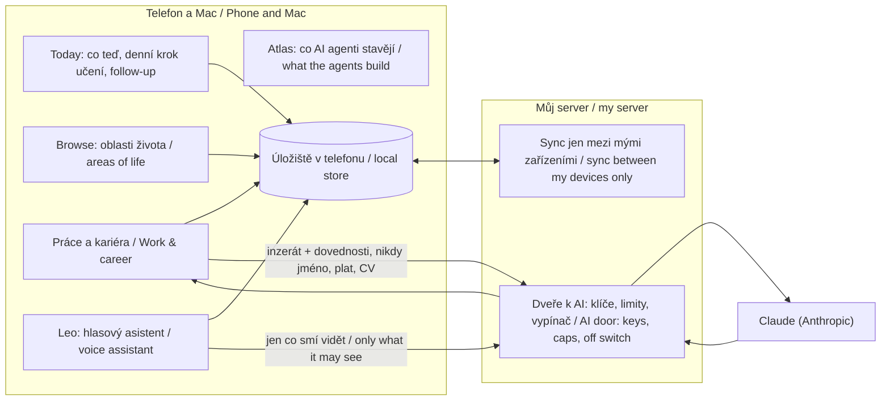

# Jak je Brian postavený a kde v něm sedí pracovní koutek
*How Brian is built and where the job corner sits*

## Jedna aplikace, jeden člověk / One app, one person

Brian je jedna webová aplikace (`index.html` a soubory, které načítá), která běží na iPhonu jako aplikace a na Macu v prohlížeči. Všechna data jsou v telefonu. Synchronizují se jen mezi mými vlastními zařízeními přes malý server (Cloudflare Worker), který také drží klíče k AI a počítá limity. Žádný účet, žádná registrace, žádné reklamy.

*Brian is one web app that runs on the iPhone as an app and on the Mac in the browser. All data is on the phone. It syncs only between my own devices through a small server (a Cloudflare Worker) that also holds the AI keys and counts the limits. No account, no sign-up, no ads.*

## Oblasti života / Areas of life

Today, kalendář, lidé (rodina, přátelé, dárky), domácnost (místnosti, údržba, spotřebiče), kuchyně (recepty, jídelníček, spíž), knihovna (články, knihy, kurzy, AI nástroje a prompty), cesty, zdraví (jen vitamíny), práce a kariéra, a Building area s Atlasem, kde vidím, co AI agenti právě stavějí, co to stojí a jaká pravidla platí. Leo je hlas nad tím vším: zapíše úkol, přečte den, udělá pohovor, zeptá se na nalezenou práci.

*Today, calendar, people, home, kitchen, library (articles, books, courses, AI tools and prompts), trips, health (vitamins only), work and career, and the Building area with Atlas, where I see what the AI agents are building, what it costs and which rules apply. Leo is the voice over all of it.*

## Pracovní koutek / The job corner

| Část / Part | Co dělá / What it does | AI | Soubor / File |
|---|---|---|---|
| Profil / Profile | Historie, dovednosti s úrovní, certifikáty, cíle na 1 a 3 roky, vlastními slovy | ne / no | `career-profile.js` |
| Inzerát / Ad | Uložený odkud chci: ze sdílení, z tlačítka v prohlížeči, ze schránky | ne / no | `index.html` (capture) |
| Co mám a co mi chybí / Match | Inzerát + profil → co splňuju, co ne, co první | 1 volání / 1 call | `index.html` (match), `career-profile.js` |
| Plán učení / Learning plan | Mezery → úkoly „Nauč se…" s postupem | ne / no | `career-profile.js` |
| Denní krok / Daily step | Today ráno nabídne jeden krok z plánu, s odškrtnutím | ne / no | `learn-dose.js` |
| Cvičný pohovor / Interview practice | 5 otázek k inzerátu, odpovědi, zpětná vazba jen z toho, co je v profilu | 2 volání / 2 calls | `interview-practice.js` |
| Kde se ucházet / Where to apply | Cíle + dovednosti → asi 5 inzerátů, max 3× denně | 1 volání + web / 1 call + web | `index.html` |
| Denní hledání / Daily search | Jednou denně samo, Leo se zeptá nahlas | 1 volání / 1 call | `proxy/`, `leo-panel.js` |
| Žádosti / Applications | Fáze, follow-up na Today po X dnech, koncept žádosti | ne / no | `index.html` |

## Čas a postup / Time and progress

Krok učení není jen úkol. Brian ví, kolik mám dnes volného času mezi schůzkami, a chystá se („Plan my day", ve stavbě) nabídnout učení do volného bloku, když ho mám víc. Každý krok, který odškrtnu, posune ukazatel u mezery v plánu, takže vidím, co už umím a jak rychle jdu, ne jen, co mi chybí.

*A learning step is not only a task. Brian knows how much free time I have today between appointments and is being taught ("Plan my day", in progress) to offer learning into a free block when I have more. Every step I tick moves the bar on that gap in the plan, so I see what I already know and how fast I move, not only what I miss.*

## Pravidla, pod kterými to vzniklo / The rules it was built under

Každá změna na vlastní větvi, s testem, který před ní padá a po ní prochází. Nezávislá kontrola jinou AI relací. Nic na živou aplikaci jinak než z mého počítače, se zálohou a zkouškou na testovací kopii. Žádná skutečná data v repozitářích. Každá placená služba má psaný strop. Celé znění pravidel je dvacet čtyři bodů v jednom souboru, který agenti čtou při každém startu.

*Every change on its own branch, with a test that fails before and passes after. An independent review by another AI session. Nothing reaches the live app except from my computer, with a backup and a rehearsal on a test copy. No real data in repositories. Every paid service has a written ceiling. The full rules are twenty-four points in one file the agents read at every start.*
